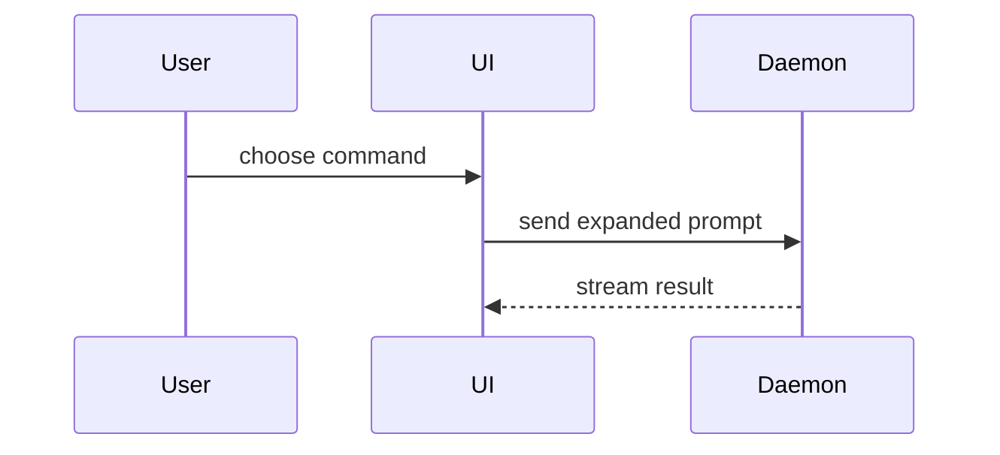

Help the user understand the current topic of conversation visually. Skip the preamble and keep prose brief. Pick the smallest view that makes the key point clear.

- Show logic or an algorithm as pseudocode:

```text
on(save)
  if content is unchanged
    return cached result
  write new content
  return fresh result
```

- Show runtime control flow as a call tree:

```text
submitForm
  createSession
    persistPrompt
    launchAgent
  navigateToSession
```

- Show UI structure as a component tree, including state and module boundaries that matter:

```tsx
<SessionPage> (apps/example/src/routes/session.tsx)
  useSessionEvents()
  <SessionToolbar>
    <RunSkillButton> (packages/ui)
```

- Show file responsibility or a broad refactor as a shallow file tree:

```text
src/
├── commands/       # parses user actions
├── sessions/       # owns session state
└── transport/      # sends API requests
```

- Show component interaction, control flow, or data flow with Mermaid when the conversation surface renders it:



- Use `diff` when the point is what changes and the surrounding shape already exists. Match the diff shape to the topic.

For a component change:

```diff
 <SessionPage>
   useSessionEvents()
   <SessionToolbar>
+    <RunSkillButton />
   <SessionTimeline>
+    <SkillResultCard />
```

For a file-layout change:

```diff
 src/
 ├── commands/
+│   └── show-me.ts       # expands the slash command
 ├── sessions/
-└── transport.ts
+└── transport/
+    ├── client.ts
+    └── stream.ts
```

For a call-tree or call-stack change:

```diff
 submitForm
   createSession
     persistPrompt
+    expandSkillMention
     launchAgent
-  navigateToSession
+  navigateToSession
+    subscribeToEvents
```

For a state or control-flow change:

```diff
 on(save)
-  write content
+  if content is unchanged
+    return cached result
+  write new content
+  invalidate cache
```

- Show the whole block when most of it is new, when omitted context would hide ownership or order, or when the user needs a copyable target shape:

```ts
function expandSkill(command: string): string {
  const skillName = command.slice(1)
  return `use the ${skillName} skill`
}
```

- For a visual UI, layout, state comparison, or concept too dense for Mermaid, write one focused HTML file — a diagram, an infographic, or a short slide deck, whichever fits the point. Match the product's colors, type, spacing, and components; use real labels and data; support desktop and mobile. Then open it for the user:

```sh
open ".show-me/show-me-{description}.html"
```

## Diagrams

Include a diagram when text alone would force the reader to mentally reconstruct a structure, track several relationships, or compare changing states. Skip it when prose, code, a tree, or a table is already clear.

Place each diagram beside the short explanation it supports. Expose only the relevant structure, execution, or change in state. Use the same concrete names, states, and values in the visual and prose.

Generate and show the visual; do not just suggest one. Use Mermaid for simple diagrams when the conversation surface renders it. Otherwise, default to Graphviz for static structures and flows. Use D3 with HTML/SVG when interaction or step-by-step state changes clarify the point. Use ELK with SVG only when compound graphs or explicit ports need more layout control. Do not substitute diagram source for a rendered visual unless asked; pseudocode, code, and text trees remain appropriate when they are the clearest view.

Before rendering, check that the required tools are available (`dot -V` for Graphviz; `npx --version` and the required packages for D3 or ELK). If a required tool or package is missing, ask the user to install it or use an available format that communicates the same point. Do not create environments, install packages, or add dependencies to the user's project. Convert SVG to PNG only if inspection or the user's requested format requires it.

Let the primary relationships determine the layout. Split crowded views or show successive states. Render and inspect the output, fixing misleading placement, overlaps, unreadable labels, and confusing connections before presenting it. If inspection is unavailable, say so.

## Artifact location

Save generated HTML and diagram artifacts under `.show-me/` in the current project or workspace (create it if needed), unless the user names another location. Use descriptive kebab-case filenames, such as `.show-me/session-event-flow.html`, and keep supporting assets alongside them with relative links. These are generated visual aids, not product source files. Return the artifact path and open HTML in the user's browser when a suitable command is available (`open` on macOS, `xdg-open` on Linux); otherwise provide the path for the user to open.

## Guidance

Place each visual next to the short text it supports. Keep only the calls, files, props, states, and boundaries needed to answer the user's current question or the options to resolve the current discussion point.

You may use one of these, you may use several, it is unlikely you will use all of them. Use your judgement and don't overwhelm the user.
